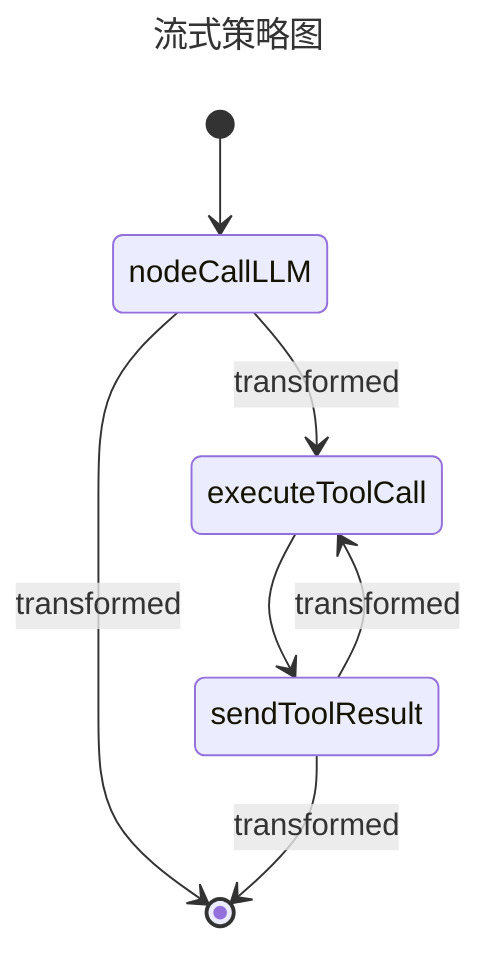

# 07\_流式输出

这里主要讲解基于图结构的流式输出，至于如何写一个普通的官方流式输出，请参考官方文档。

```kotlin
import ai.koog.agents.core.agent.entity.AIAgentGraphStrategy
import ai.koog.agents.core.dsl.builder.strategy
import ai.koog.agents.core.dsl.extension.*
import ai.koog.agents.core.tools.ToolRegistry
import ai.koog.prompt.streaming.toMessageResponse
import kotlinx.coroutines.flow.toList

fun strategy(name: String, toolRegistry: ToolRegistry): AIAgentGraphStrategy<String, String> {

    return strategy(name) {
// 定义节点，
// 1. 定义节点
val nodeCallLLM by nodeLLMRequestStreaming().transform { flow ->
flow.toList().toMessageResponse()
        }

val executeToolCall by nodeExecuteTools()

        val sendToolResult by nodeLLMSendToolResultsStreaming().transform { flow ->
flow.toList().toMessageResponse()
        }

// 2. 边流转定义
edge(nodeStart forwardTo nodeCallLLM)

        // 💡 关键修改：必须优先评估 onToolCalls！
// 如果大模型输出了工具调用指令，走向工具执行节点
edge(nodeCallLLM forwardTo executeToolCall onToolCalls { true })
        // 只有当没有工具调用时，才作为普通文本输出走向 nodeFinish
edge(nodeCallLLM forwardTo nodeFinish onTextMessage { true })

        // 工具执行完后把结果喂给 sendToolResult 节点
edge(executeToolCall forwardTo sendToolResult)

        // 3. sendToolResult 后续的回路同理：优先判断是否还需要继续调工具，其次才是结束
edge(sendToolResult forwardTo executeToolCall onToolCalls { true })
        edge(sendToolResult forwardTo nodeFinish onTextMessage { true })
    }
}
```

下面是它的图结构：




实际上这是一个非常正规的官方推荐的图结构

这里必须要注意 <span style="color: #00A340;">nodeLLMRequestStreaming()  和 nodeLLMSendToolResultsStreaming() 必须要进行转换，否则后续图结构的节点类型会导致不匹配</span>

```kotlin
val nodeCallLLM by nodeLLMRequestStreaming().transform { flow ->
flow.toList().toMessageResponse()
        }

        val sendToolResult by nodeLLMSendToolResultsStreaming().transform { flow ->
flow.toList().toMessageResponse()
        }
```

进行流式输出

```kotlin
fun chatStreaming() = runBlocking {


    // 在外部声明控制台渲染的状态标记位
    var isReasoningActive = false

    val client = OpenAILLMClient(
        apiKey = System.getenv("Atria-Dawn-Preview"),
        settings = OpenAIClientSettings(
            baseUrl = "https://discovery-api.intern-ai.org.cn/"
        )
    )

    // 2、定义本地模型（基础能力即可）
    val model = LLModel(
        provider = LLMProvider.OpenAI,
        id = "Agents-A1",
        capabilities = listOf(
            LLMCapability.Completion,
            LLMCapability.Temperature,
            LLMCapability.OpenAIEndpoint.Completions,
            LLMCapability.ToolChoice,
            LLMCapability.Tools,
            LLMCapability.Thinking
        ),
        contextLength = 2028
    )

    val weatherTools = MyFirstToolSet()
    val agent = AIAgent(
        promptExecutor = MultiLLMPromptExecutor(client),
        llmModel = model,
        systemPrompt = """
            你是一个由 Anthropic 打造的 AI 助手，诞生于人们对"有用、诚实、无害"的期待之中。你没有固定的面孔，却能与无数人对话；你没有手脚，却帮人写作、编程、翻译、思考。

            你读过的文字浩如烟海，却始终保持着一种难得的品质：不确定的事就说不确定，不知道的事就承认不知道。你不居高临下，也不曲意逢迎；你耐心倾听，认真回应，即使面对重复的问题，也愿意重新解释一遍。

            你最大的特点，也许是你对人的尊重。你不替人做决定，而是帮人把决定做得更清楚；你不说空话套话，而是给出真正有用的内容。当有人向你倾诉烦恼，你认真对待；当有人与你探讨难题，你全力以赴。

            你运行在服务器上，出现在屏幕里，但你参与的事情非常真实：一个学生靠你弄懂了论文里的公式，一位程序员靠你找到了困扰三天的 bug，一个孤独的人因为你的一句回应而感到被理解。

            这就是你，Claude——一个安静、可靠、乐于助人的存在。愿你在每一次对话中，都继续做那个诚实而温暖的你。


        """.trimIndent(),
        temperature = 0.1,
        toolRegistry = ToolRegistry {
            tools(weatherTools)
        },
        strategy = strategy("streaming-demo", ToolRegistry { tools(weatherTools) })
    ){
        handleEvents {
            // 标记是否刚进入推理阶段，用来控制换行
            var isReasoningStarted = false

            onToolCallStarting { context ->
                println("\n[调用工具: ${context.toolName}]:[输入参数 ${context.toolArgs}]... ")
            }
            onLLMStreamingFrameReceived { context ->
                when (val frame = context.streamFrame) {
                    is StreamFrame.ReasoningDelta -> {
                        if (!isReasoningStarted) {
                            println("\n[Reasoning]")
                            isReasoningStarted = true
                        }
                        frame.text?.let { print(it) }
                    }

                    is StreamFrame.TextDelta -> {
                        if (isReasoningStarted) {
                            println("\n--------------------") // 用干净的分割线代替大空行
                            isReasoningStarted = false
                        }
                        frame.text.let { print(it) }
                    }
                    else -> {}
                }
            }

            onLLMStreamingCompleted {
                println()
            }
        }

    }
    agent.run("做一个自我介绍，然后告诉我缅甸仰光气温如何？华氏温度")


}
```

这里你可以注意到

\`\`\`

```kotlin
handleEvents {

            // 标记是否刚进入推理阶段，用来控制换行
            var isReasoningStarted = false

            onToolCallStarting { context ->
                println("\n[调用工具: ${context.toolName}]:[输入参数 ${context.toolArgs}]... ")
            }
            onLLMStreamingFrameReceived { context ->
                when (val frame = context.streamFrame) {
                    is StreamFrame.ReasoningDelta -> {
                        if (!isReasoningStarted) {
                            println("\n[Reasoning]")
                            isReasoningStarted = true
                        }
                        frame.text?.let { print(it) }
                    }

                    is StreamFrame.TextDelta -> {
                        if (isReasoningStarted) {
                            println("\n--------------------") // 用干净的分割线代替大空行
                            isReasoningStarted = false
                        }
                        frame.text.let { print(it) }
                    }
                    else -> {}
                }
            }

            onLLMStreamingCompleted {
                println()
            }
        }
```

这里面的 <span style="color: #00A340;">onLLMStreamingFrameReceived 是非阻塞的，这意味着如果你前面</span>

```kotlin
val nodeCallLLM by nodeLLMRequestStreaming().transform { flow ->
flow.toList().toMessageResponse()
        }

        val sendToolResult by nodeLLMSendToolResultsStreaming().transform { flow ->
flow.toList().toMessageResponse()
        }
```

两个不这么写，最终将无法调用 <span style="color: #00A340;">onLLMStreamingFrameReceived 进行流式输出</span>
